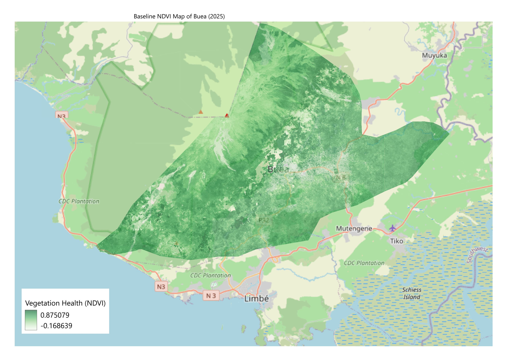

# Mount Cameroon Resilient Landscapes & Early Warning System

A cloud-based geospatial monitoring system developed for **Green Cameroon** (UN ECOSOC Accredited) to track forest degradation, landslide risk, and climate-driven vegetation shifts around Mount Cameroon.

## 🌍 About Mount Cameroon
Mount Cameroon is an active volcano and one of the most biologically diverse regions in West Africa. It is home to rare Afro-montane forests and endangered species. However, the region faces severe environmental threats, including agricultural encroachment, illegal logging, and climate-driven landslides. 

This project divides the mountain into three thematic zones to monitor these specific threats:
*   **Zone 1 (Lowland/Buea):** Monitoring deforestation and agricultural encroachment.
*   **Zone 2 (Mid-Elevation Slopes):** Mapping landslide risk and illegal logging.
*   **Zone 3 (High-Altitude):** Assessing climate change impacts on Afro-montane vegetation.

## 📍 Baseline Assessment: Buea (2025)
Below is the Week 1 baseline Vegetation Health (NDVI) map generated from Sentinel-2 satellite imagery. The map integrates official GADM administrative boundaries and OpenStreetMap context layers to provide a clear picture of forest health around the Buea subdivision.

## ☁️ Cloud Infrastructure & Data Security
To ensure that critical environmental data is never lost again and remains permanently accessible, this project is built entirely on a secure cloud infrastructure:
*   **Satellite Processing:** Google Earth Engine (Sentinel-2)
*   **Version Control & Code:** GitHub
*   **Data Storage:** Google Drive
*   **Cartography:** QGIS

## 🎯 Project Goals
*   Establish a reproducible cloud-based GIS baseline for the region.
*   Model landslide risk using high-resolution terrain data (DEM).
*   Develop a grant proposal to secure international funding for ongoing conservation efforts.
